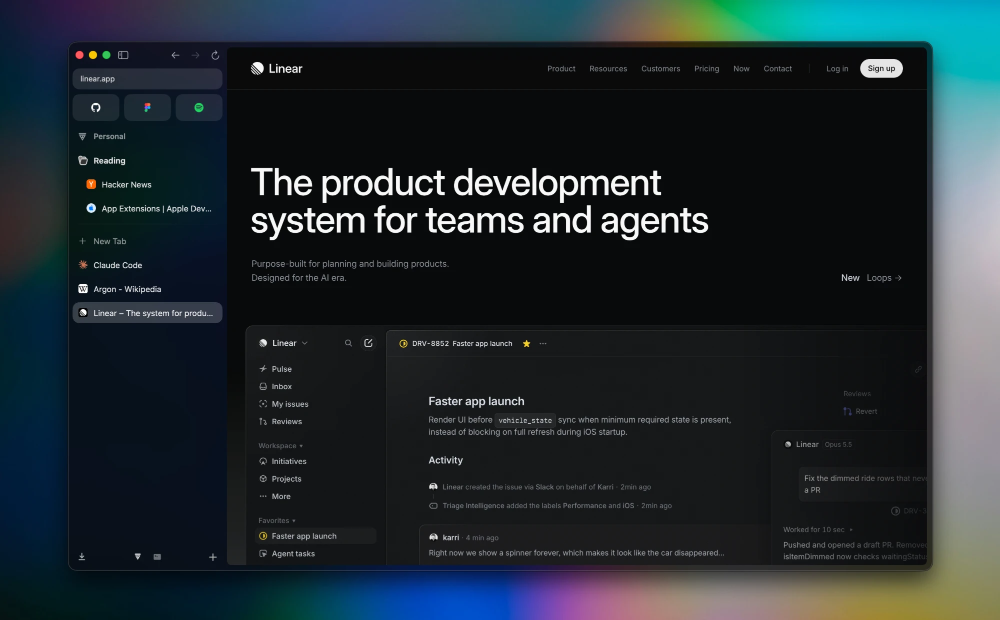

# Argon

An Arc-style browser for macOS. A native Swift + AppKit app owns the whole
interface: sidebar, spaces, command bar and page card. Chromium supplies the
engine and Chrome's back-end services.



See [docs/features.md](docs/features.md) for everything Argon does.

## Installation

Argon needs an Apple silicon Mac running macOS 13 or later.

1. Download the latest `Argon-<version>-arm64.dmg` from
   [Releases](https://github.com/xtanion/argon/releases).
2. Open the DMG and drag Argon into Applications.
3. Open Argon from Applications.

Later versions install from the update card at the bottom of the sidebar.

### "Apple could not verify Argon"

Argon is signed with a free Apple development certificate, not a paid
Developer ID, so Apple hasn't notarized it. The first time you open it, macOS
blocks it with a warning that it can't check the app for malicious software.
To open it anyway:

1. Click **Done** on the warning.
2. Open **System Settings > Privacy & Security** and scroll down to Security.
3. Next to "Argon was blocked to protect your Mac", click **Open Anyway**.
4. Confirm with **Open Anyway** again and enter your password.

You only need to do this once. Right-clicking the app and choosing Open no
longer skips this check on recent macOS versions.

If you'd rather use Terminal, clear the quarantine flag instead:

```sh
xattr -dr com.apple.quarantine /Applications/Argon.app
```

## Why Argon?

> Arc's sunsetting made me sad, and it was time to switch. I gave every other
> browser a shot, but each one was either too heavy, too slow, not
> Chromium-based, or filled with AI slop. So I decided to build my own.

## Why a native app on Chromium

Chromium's window layer ties each window to one profile. Arc-style spaces need
tabs from several profiles in one window, and a native-feeling interface keeps
fighting Chromium's window code. Arc solves this by shipping no Chromium window
code at all, with its own app on top of the engine. Argon does the same.

## How it fits together

```
Argon.app                      app/      Swift + AppKit
  sidebar, spaces, tab list, command bar, downloads, prompts, settings shell
        |  Obj-C API (core/public: ACTab, ACProfile, ACAutocomplete, ...)
ArgonCore                      core/     linked into Chromium as //argon_core
  tabs as plain WebContents in AppKit views, one profile per space
  Chrome services reused as-is: profiles, history, omnibox, permissions,
  downloads, passwords, autofill, extensions, WebAuthn, DevTools
        |
Chromium 157 (~/chromium/src) + patches/argon/embedder-hooks.patch
```

- Each tab is a `WebContents` from its space's profile. Its view sits directly
  in an AppKit view, so tabs from different profiles share one window.
- Chrome keeps the logic and Argon draws the UI. Examples: permission prompts
  through `PermissionPrompt`, tab-modal dialogs through
  `WebContentsModalDialogHost`, address-bar results through
  `AutocompleteController`, and docked DevTools through an embedder hook in
  `DevToolsWindow`.

## Repository layout

```
app/              Argon.app: XcodeGen project.yml, Sources/*.swift, scripts/
core/             ArgonCore: app/ (startup), browser/ (tabs, profiles, prompts),
                  public/ (Obj-C API for Swift)
patches/argon/    Chromium changes Argon needs (embedder-hooks.patch)
plan.md           architecture and milestones
design.md         interface spec
docs/building.md  build and dev loop
```

Helium's ungoogled-chromium packaging pipeline (`build.sh`, `downloads*.ini`,
the engine and privacy patch series) lives in the helium-macos fork and isn't
part of this repo.

## Building

See [docs/building.md](docs/building.md). In short: plain Chromium checkout,
symlink `core/` in as `//argon_core`, apply the embedder patch, run
`autoninja -C out/Core chrome`, then `xcodegen` and `xcodebuild` in `app/`.

## Status

Usable as a daily browser. Working:

- Spaces, each with its own profile
- Pinned sites and favourites
- Command bar on Chrome's omnibox, with history and inline completion
- Permissions and camera/mic
- Downloads panel (in progress)
- Passkeys via phone or security key
- HTTP auth
- Context menus
- File upload and JS dialogs
- Docked DevTools

Open items are tracked in [plan.md](plan.md). iCloud Keychain passkeys need
Apple's browser passkey entitlement for the `dev.argon.browser` bundle id.

## Credits

Argon grew out of a fork of [helium-macos](https://github.com/imputnet/helium-macos),
the macOS packaging for the [Helium browser](https://github.com/imputnet/helium).
That in turn is based on
[ungoogled-chromium-macos](https://github.com/ungoogled-software/ungoogled-chromium-macos).
Thanks to everyone behind Helium and ungoogled-chromium.

## License

All code, patches, modified portions of imported code or patches, and any other
content unique to this repository is licensed under GPL-3.0. See
[LICENSE](LICENSE).

Content imported from other projects keeps its original license. For example,
unmodified code from ungoogled-chromium remains under its
[BSD 3-Clause license](LICENSE.ungoogled_chromium).
